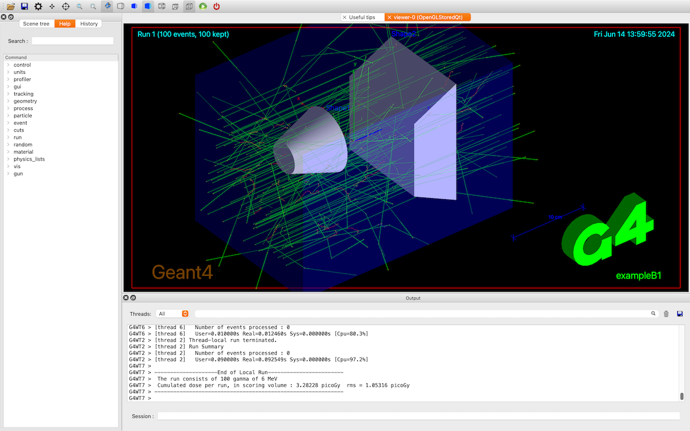

# B1したい（``examples/basic/B1/``）



`basic/B1`は、Geant4アプリケーションの最小構成を示すサンプルです。
簡単な検出器の形状を定義し、一次粒子を入射させ、物質中でのエネルギー損失を記録する、という基本的な流れを確認できます。

まず、`B1`サンプルをビルドして実行し、
マクロファイルを編集して、粒子の種類やエネルギーを変更してみるとよいです。

## ビルドしたい（`cmake`）

```console
// サンプルと作業ディレクトリを設定する（パスは自分の環境に合わせる）
$ export G4EXAMPLE=~/geant4/v11.X.Y/install/share/Geant4/examples/basic/B1
$ export G4WORK=~/repos/sandbox/g4work

// 作業ディレクトリ（B1/app）にコピーして移動する
$ mkdir -p $G4WORK/B1
$ cp -R $G4EXAMPLE $G4WORK/B1/app
$ cd $G4WORK/B1

// ビルドする（ソースは app/、ビルド用ディレクトリは build/）
$ cmake -S app -B build
$ cmake --build build --parallel

// 実行する
$ cd build
$ ./exampleB1 run1.mac    # バッチモード
$ ./exampleB1 run2.mac    # バッチモード（イベント数が多い）
$ ./exampleB1             # 対話モード

// クリーンする
$ cd $G4WORK/B1
$ cmake --build build --target clean    # ビルドした実行ファイルなどを削除する
$ rm -r build                           # ビルド用ディレクトリごと削除する
```

`cmake`でビルドし、`exampleB1`という実行ファイルを作成します。
ソースは`B1/app`に、ビルド用ディレクトリは`B1/build`に分けます（out-of-sourceビルド）。
手順の詳しい説明は、[付属サンプルの遊び方](geant4-examples)を参照してください。

実行ファイルは、`build/`の中に作成されます。
`B1`の`CMakeLists.txt`は、マクロファイル（`run1.mac`など）を`build/`にコピーするので、`build/`で実行できます。
`./exampleB1`を実行するときにマクロファイルを指定するとバッチモード、指定しないと対話モードになります。

- `run1.mac`：ガンマ線（6 MeV）を5イベント、続けて陽子（210 MeV）を1イベント入射します
- `run2.mac`：ガンマ線（6 MeV）と陽子（210 MeV）を、それぞれ10000イベント入射します

## メイン（`exampleB1.cc`）

```cpp
//////////////////////////////////////////////////
// exampleB1.cc（一部を省略）
//////////////////////////////////////////////////
int main(int argc, char** argv)
{
  // 引数がなければ対話モード
  G4UIExecutive* ui = nullptr;
  if (argc == 1) {
    ui = new G4UIExecutive(argc, argv);
  }

  auto runManager = G4RunManagerFactory::CreateRunManager(G4RunManagerType::Default);

  // Detector construction
  runManager->SetUserInitialization(new DetectorConstruction());

  // Physics list
  auto physicsList = new QBBC;
  physicsList->SetVerboseLevel(1);
  runManager->SetUserInitialization(physicsList);

  // User action initialization
  runManager->SetUserInitialization(new ActionInitialization());

  // Initialize visualization
  auto visManager = new G4VisExecutive(argc, argv);
  visManager->Initialize();

  auto UImanager = G4UImanager::GetUIpointer();

  if (!ui) {
    // batch mode
    G4String command = "/control/execute ";
    G4String fileName = argv[1];
    UImanager->ApplyCommand(command + fileName);
  }
  else {
    // interactive mode
    UImanager->ApplyCommand("/control/execute init_vis.mac");
    ui->SessionStart();
    delete ui;
  }
}
```

メインプログラムは`exampleB1.cc`です。
ここでは、Geant4アプリケーション全体を制御するための各種マネージャーが生成・設定されています。

まず
`G4RunManagerFactory`によってランマネージャーが作成され、
検出器（`DetectorConstruction`）、
物理リスト、
ユーザーアクション（`ActionInitialization`）
が登録されます。
その後、
`G4VisExecutive`で可視化が初期化されます。
これらのマネージャーにより、マクロコマンドの入力や、
イベント・検出器の表示が可能になります。

最後に、実行方法を切り替えています。
引数がなければ、`init_vis.mac`を実行して対話モードを開始します。
引数があれば、それをマクロファイルとして実行し、バッチモードになります。
`G4UIExecutive`は、対話モードのときだけ作成されます。

## 検出器したい（`DetectorConstruction`）

検出器の形状や材料は`DetectorConstruction`クラスで定義します。
`basic/B1`では、
シミュレーション空間全体を表すWorldボリューム（箱形状、空気）を作成し、
その内部にEnvelopeボリューム（箱形状、水）を配置しています。
さらにEnvelopeの中に、`Shape1`（円錐形状、`G4_A-150_TISSUE`）と`Shape2`（台形形状、`G4_BONE_COMPACT_ICRU`）の2つのボリュームを配置しています。

また、エネルギー損失を記録するための`Scoring Volume`もここで設定しています。
`Scoring Volume`は`Shape2`です。

:::{note}

`basic/B1`はSensitive Detectorを使いません。
Sensitive Detectorを使ったヒット情報の扱いは、
`basic/B2`などのサンプルを参照してください。

:::

## 物理リストしたい（`QBBC`）

`basic/B1`では、Geant4標準のモジュール型物理リストにある`QBBC`モデルを使っています。
`QBBC`は、電磁相互作用、ハドロン相互作用、崩壊過程などを含んだ汎用的で安全な物理リストです。
詳しくは[](./geant4-physics-qbbc.md)を参照してください。

## 入射粒子したい（`PrimaryGeneratorAction`）

`basic/B1`の入射粒子は、
`PrimaryGeneratorAction`で`G4ParticleGun`を使って定義されています。
初期状態では、ガンマ線を6 MeVで +Z方向に入射しています。

入射粒子の設定はマクロで変更できます。
粒子の種類やエネルギー、イベント数などをマクロファイルで指定できるため、再ビルドせずに条件を切り替えて試すことができます。

入射位置は、Envelopeの中で`G4UniformRand()`を使ってランダムに決めています。
Envelopeの寸法は`G4LogicalVolumeStore`から取得するので、`PrimaryGeneratorAction`は`DetectorConstruction`に依存しません。

```cpp
// B1::PrimaryGeneratorAction::GeneratePrimaries()（一部）
G4double size = 0.8;
G4double x0 = size * envSizeXY * (G4UniformRand() - 0.5);
G4double y0 = size * envSizeXY * (G4UniformRand() - 0.5);
G4double z0 = -0.5 * envSizeZ;

fParticleGun->SetParticlePosition(G4ThreeVector(x0, y0, z0));
```

## ディレクトリ構造

```console
$ tree B1 -L 2
B1
├── CMakeLists.txt
├── GNUmakefile
├── History
├── README.md
├── exampleB1.cc
├── include
│   ├── ActionInitialization.hh
│   ├── DetectorConstruction.hh
│   ├── EventAction.hh
│   ├── PrimaryGeneratorAction.hh
│   ├── RunAction.hh
│   └── SteppingAction.hh
├── src
│   ├── ActionInitialization.cc
│   ├── DetectorConstruction.cc
│   ├── EventAction.cc
│   ├── PrimaryGeneratorAction.cc
│   ├── RunAction.cc
│   └── SteppingAction.cc
├── init_vis.mac
├── vis.mac
├── exampleB1.in
├── exampleB1.out
├── run1.mac
└── run2.mac
```

B1のディレクトリ構造は上のようになっています。
メインのプログラムは``exampleB1.cc``で、``include/*.hh``と``src/*.cc``に関係するソースコードが格納されています。
``*.mac``は実行ファイルの引数に指定できるマクロファイルです。

``exampleB1.in``もマクロファイルです。
これを読み込んだときの出力が``exampleB1.out``です。

## ステップごとにエネルギー損失を集計したい（`SteppingAction`）

`SteppingAction::UserSteppingAction()`は、ステップごとに呼ばれます。
そのステップがScoring Volume（`Shape2`）の中かどうかを確かめ、中ならそのステップのエネルギー損失を`EventAction`に渡します。

```cpp
// B1::SteppingAction::UserSteppingAction()（一部）
// get volume of the current step
G4LogicalVolume* volume =
  step->GetPreStepPoint()->GetTouchableHandle()->GetVolume()->GetLogicalVolume();

// check if we are in scoring volume
if (volume != fScoringVolume) return;

// collect energy deposited in this step
G4double edepStep = step->GetTotalEnergyDeposit();
fEventAction->AddEdep(edepStep);
```

## ランごとに線量を集計したい（`RunAction`）

`EventAction`は、イベントごとのエネルギー損失を`RunAction::AddEdep()`に渡します。
`RunAction`では、エネルギー損失の合計と二乗和を`G4AccumulableManager`に登録しておき、ランの終わりに`Merge()`で集計します。

線量は、合計のエネルギー損失をScoring Volumeの質量で割って求めます。

```cpp
// B1::RunAction::EndOfRunAction()（一部）
G4double mass = detConstruction->GetScoringVolume()->GetMass();
G4double dose = edep / mass;
G4double rmsDose = rms / mass;

G4cout << " Absorbed dose per run in scoring volume = edep/mass = " << G4BestUnit(dose, "Dose")
       << "; rms = " << G4BestUnit(rmsDose, "Dose") << G4endl;
```

`G4BestUnit(dose, "Dose")`は、値の大きさに合わせて単位を選びます。
`RunAction`のコンストラクタでは、`milliGy`や`microGy`などの単位を`G4UnitDefinition`で追加しています。

## リファレンス

- [Example B1](https://geant4-userdoc.web.cern.ch/Doxygen/examples_doc/html/ExampleB1.html)
