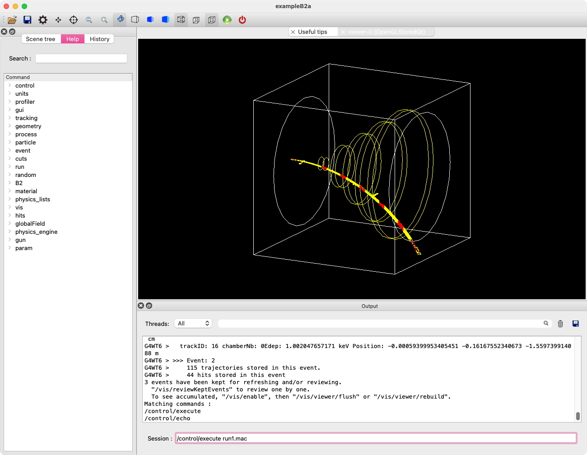

# B2したい（`examples/basic/B2`）



`examples/basic/B2`は、固定標的と複数のチェンバーを並べた飛跡検出器です。
外部磁場を与え、粒子が曲がる様子を観察できます。
`Sensitive Detector`と`Hit`の扱いを学ぶことができます。

`examples/basic/B2/`の中には、`B2a`と`B2b`のディレクトリがあります。
どちらも同じ装置をシミュレーションしますが、チェンバーの作り方が違います。
`B2a`は単純な円筒としてチェンバーを配置し、`B2b`はパラメータ化されたボリューム（`G4PVParameterised`）として配置します。

`B2a`と`B2b`は、それぞれ独立したプロジェクトです。
使いたいほうだけをコピーして、ビルドします。

## ビルドしたい（`B2a`）

```console
// サンプルと作業ディレクトリを設定する（パスは自分の環境に合わせる）
$ export G4EXAMPLE=~/geant4/v11.X.Y/install/share/Geant4/examples/basic/B2/B2a
$ export G4WORK=~/repos/sandbox/g4work

// 作業ディレクトリにコピーして移動する
$ mkdir -p $G4WORK
$ cp -R $G4EXAMPLE $G4WORK/
$ cd $G4WORK/B2a

// ビルドする
$ cmake -S . -B build
$ cmake --build build --parallel

// 実行する
$ cd build
$ ./exampleB2a run1.mac    # バッチモード
$ ./exampleB2a             # 対話モード

// クリーンする
$ cd $G4WORK/B2a
$ cmake --build build --target clean    # ビルドした実行ファイルなどを削除する
$ rm -r build                           # ビルド用ディレクトリごと削除する
```

`cmake`でビルドし、`exampleB2a`という実行ファイルを作成します。
手順の詳しい説明は、[付属サンプルの遊び方](geant4-examples)を参照してください。

実行ファイルは、`build/`の中に作成されます。
`B2a`の`CMakeLists.txt`は、マクロファイル（`run1.mac`など）を`build/`にコピーするので、`build/`で実行できます。
`./exampleB2a`を実行するときにマクロファイルを指定するとバッチモード、指定しないと対話モードになります。

## ビルドしたい（`B2b`）

```console
// サンプルと作業ディレクトリを設定する（パスは自分の環境に合わせる）
$ export G4EXAMPLE=~/geant4/v11.X.Y/install/share/Geant4/examples/basic/B2/B2b
$ export G4WORK=~/repos/sandbox/g4work

// 作業ディレクトリにコピーして移動する
$ mkdir -p $G4WORK
$ cp -R $G4EXAMPLE $G4WORK/
$ cd $G4WORK/B2b

// ビルドする
$ cmake -S . -B build
$ cmake --build build --parallel

// 実行する
$ cd build
$ ./exampleB2b run1.mac    # バッチモード
$ ./exampleB2b             # 対話モード

// クリーンする
$ cd $G4WORK/B2b
$ cmake --build build --target clean    # ビルドした実行ファイルなどを削除する
$ rm -r build                           # ビルド用ディレクトリごと削除する
```

実行ファイルは`exampleB2b`です。
手順は`B2a`と同じです。`B2b`の`run1.mac`は、`B2a`と同じ内容です。

## メイン（`exampleB2a.cc`）

```cpp
//////////////////////////////////////////////////
// exampleB2a.cc（一部を省略）
//////////////////////////////////////////////////
auto runManager = G4RunManagerFactory::CreateRunManager(G4RunManagerType::Default);

// Detector construction
runManager->SetUserInitialization(new B2a::DetectorConstruction());

// Physics list
auto physicsList = new FTFP_BERT;
physicsList->RegisterPhysics(new G4StepLimiterPhysics());
runManager->SetUserInitialization(physicsList);

// User action initialization
runManager->SetUserInitialization(new B2::ActionInitialization());
```

メインプログラムは`exampleB2a.cc`です。
`G4RunManagerFactory`でランマネージャーを作成し、検出器（`B2a::DetectorConstruction`）、物理リスト、ユーザーアクション（`B2::ActionInitialization`）を登録しています。
物理リストには、`FTFP_BERT`に`G4StepLimiterPhysics`を追加しています。

実行方法の切り替えは`B1`と同じです。
引数がなければ対話モードで、`init_vis.mac`を実行します。GUIが使える場合は、さらに`gui.mac`も実行します。
引数があれば、それをマクロファイルとして実行するバッチモードになります。

## 検出器したい（`DetectorConstruction`）

`B2a`の検出器は、固定標的と複数の円筒型トラッカーで構成されています。
固定標的は入射粒子が最初に衝突する部分で、その材質はマクロで変更できます。

円筒型トラッカーは、ターゲットと同軸に複数枚配置されています。
それぞれ`Sensitive Detector`に割り当てられ、ヒット情報やエネルギー損失を記録できるようになっています。
トラッカーの材質もマクロで変更できます。

## 物理リストしたい（`FTFP_BERT`）

`basic/B2`では、Geant4標準のモジュール型物理リストにある`FTFP_BERT`モデルを使っています。
`FTFP_BERT`は、高エネルギー側で`FTFP`、低エネルギー側で`BERT`に自動で切り替わるようになっている物理モデルです。

さらに`G4StepLimiterPhysics`を追加しています。
これは、トラッカー領域のステップ長の上限（`/B2/det/stepMax`）を有効にするために必要です。

## 入射粒子したい（`PrimaryGeneratorAction`）

入射粒子は`PrimaryGeneratorAction`で`G4ParticleGun`を使って生成されます。
初期状態では、陽子を3 GeVで +Z方向に入射しています。
この粒子の種類やエネルギーは、マクロ（`/gun/particle`や`/gun/energy`）で変更できます。

## 一様磁場したい（`G4GlobalMagFieldMessenger`）

`B2a`サンプルでは、飛跡検出器全体に一様な磁場を設定できます。
磁場は`G4GlobalMagFieldMessenger`で定義されます。

```cpp
// B2a::DetectorConstruction::ConstructSDandField()
G4ThreeVector fieldValue = G4ThreeVector();
fMagFieldMessenger = new G4GlobalMagFieldMessenger(fieldValue);
fMagFieldMessenger->SetVerboseLevel(1);
```

```cfg
# run1.mac
/globalField/verbose 1
/globalField/setValue 0.2 0 0 tesla
```

ソースでは、磁場の値をゼロ（`G4ThreeVector()`）にして`G4GlobalMagFieldMessenger`を作成しています。
このクラスが`/globalField/`以下のコマンドを提供するので、マクロの`/globalField/setValue`で磁場を設定できます。
値を非ゼロにすると一様な磁場が自動的に作られ、荷電粒子の飛跡が曲がるようになります。

## ``run1.mac``

``run1.mac``では5つの条件で粒子を入射しています。

```cfg
# 入射粒子: デフォルト値（種類: 陽子、エネルギー: 3 GeV、方向: (0, 0, 1)）
# 表示レベル: 変更あり
/tracking/verbose 1
/run/beamOn 1
```

```cfg
# 入射粒子: デフォルト値
# 表示レベル: 変更あり
/tracking/verbose 0
/hits/verbose 2
/run/beamOn 1
```

```cfg
# 入射粒子: デフォルト値
# 表示レベル: 変更なし
## /tracking/verbose 0
## /hits/verbose 2
# ターゲットの材料を変更
/B2/det/setTargetMaterial G4_WATER
/B2/det/setChamberMaterial G4_Ar
/run/beamOn 3
```

```cfg
# 入射粒子: 陽子、エネルギー: 0.3GeVに変更
# 表示レベル: 変更なし
## /tracking/verbose 0
## /hits/verbose 2
# 磁場を印加
/globalField/verbose 1
/globalField/setValue 0.2 0 0 tesla
/B2/det/stepMax 1.0 mm
/gun/energy 0.3 GeV
/run/beamOn 3
```

```cfg
# 入射粒子: ミューオン（mu-）、エネルギー: 300 MeVに変更
# 表示レベル: 変更なし
/gun/particle mu-
/gun/energy 300 MeV
/run/beamOn 3
```

## リファレンス

- [Example B2](https://geant4-userdoc.web.cern.ch/Doxygen/examples_doc/html/ExampleB2.html)
