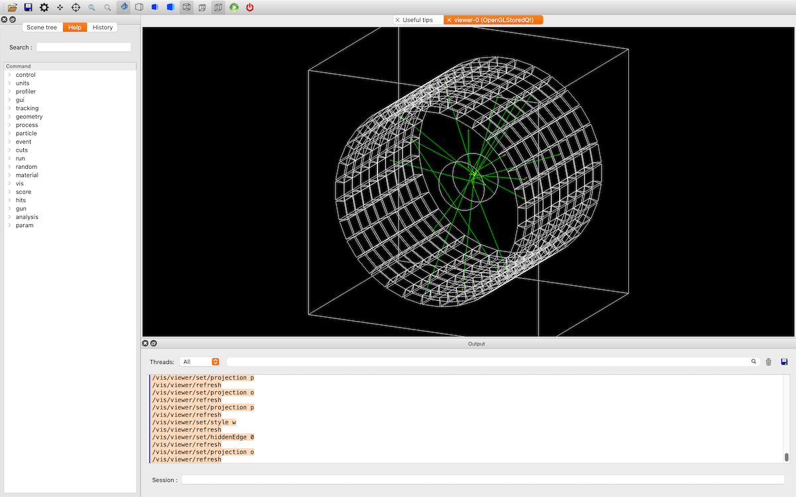

# B3したい（`examples/basic/B3`）



B3の題材はPET（陽電子放出断層撮影）です。
患者の頭を円柱とし、その周りを結晶（LSO）で作ったガンマ線検出器で取り囲んでいます。

`examples/basic/B3/`の中には、`B3a`と`B3b`のディレクトリがあります。
形状、放射線源、物理リストは同じです。違いは、シミュレーション結果の集計方法です（後の「B3aとB3bの違い」を参照）。

`B3a`と`B3b`は、それぞれ独立したプロジェクトです。
使いたいほうだけをコピーして、ビルドします。

## ビルドしたい（`B3a`）

```console
// サンプルと作業ディレクトリを設定する（パスは自分の環境に合わせる）
$ export G4EXAMPLE=~/geant4/v11.X.Y/install/share/Geant4/examples/basic/B3/B3a
$ export G4WORK=~/repos/sandbox/g4work

// 作業ディレクトリにコピーして移動する
$ mkdir -p $G4WORK
$ cp -R $G4EXAMPLE $G4WORK/
$ cd $G4WORK/B3a

// ビルドする
$ cmake -S . -B build
$ cmake --build build --parallel

// 実行する
$ cd build
$ ./exampleB3a run1.mac    # バッチモード
$ ./exampleB3a             # 対話モード

// クリーンする
$ cd $G4WORK/B3a
$ cmake --build build --target clean    # ビルドした実行ファイルなどを削除する
$ rm -r build                           # ビルド用ディレクトリごと削除する
```

`cmake`でビルドし、`exampleB3a`という実行ファイルを作成します。
手順の詳しい説明は、[付属サンプルの遊び方](geant4-examples)を参照してください。

## ビルドしたい（`B3b`）

```console
// サンプルと作業ディレクトリを設定する（パスは自分の環境に合わせる）
$ export G4EXAMPLE=~/geant4/v11.X.Y/install/share/Geant4/examples/basic/B3/B3b
$ export G4WORK=~/repos/sandbox/g4work

// 作業ディレクトリにコピーして移動する
$ mkdir -p $G4WORK
$ cp -R $G4EXAMPLE $G4WORK/
$ cd $G4WORK/B3b

// ビルドする
$ cmake -S . -B build
$ cmake --build build --parallel

// 実行する
$ cd build
$ ./exampleB3b run1.mac    # バッチモード
$ ./exampleB3b             # 対話モード

// クリーンする
$ cd $G4WORK/B3b
$ cmake --build build --target clean    # ビルドした実行ファイルなどを削除する
$ rm -r build                           # ビルド用ディレクトリごと削除する
```

実行ファイルは`exampleB3b`です。
手順は`B3a`と同じです。

## B3aとB3bの違い

`B3a`と`B3b`は、検出器のヒットを集計する方法だけが違います。

| 項目 | `B3a` | `B3b` |
| --- | --- | --- |
| イベントごとの処理 | `EventAction`で、結晶のエネルギー付与を調べる | `Run::RecordEvent()`で、同じ情報を調べる |
| 集計の仕組み | `G4Accumulable`を登録し、ラン終了時に`Merge()`する | `G4Run`を継承した`Run`クラスで、ランの中で数える |
| 結果の表示 | `RunAction::EndOfRunAction()`で表示する | `Run::Merge()`で集計してから表示する |

どちらも、結晶と患者のスコアリングには`G4MultiFunctionalDetector`（`crystal`と`patient`）を使っています。
`G4Accumulable`と`G4Run`の2つの方法を比べると、マルチスレッドでの集計の仕組みが理解しやすくなります。

## 患者の頭部を作りたい（`DetectorConstruction`）

患者の頭は、脳の組織（`G4_BRAIN_ICRP`）でできた円柱として作ります。

```cpp
// 半径 8 cm、長さ 10 cm の円柱
G4double patient_radius = 8 * cm;
G4double patient_dZ = 10 * cm;
G4Material* patient_mat = nist->FindOrBuildMaterial("G4_BRAIN_ICRP");

auto solidPatient = new G4Tubs("Patient", 0., patient_radius, 0.5 * patient_dZ, 0., twopi);

auto logicPatient = new G4LogicalVolume(solidPatient,  // its solid
                                        patient_mat,  // its material
                                        "PatientLV");  // its name

// 患者をワールドの中心に置く
new G4PVPlacement(nullptr,  // no rotation
                  G4ThreeVector(),  // at (0,0,0)
                  logicPatient,  // its logical volume
                  "Patient",  // its name
                  logicWorld,  // its mother  volume
                  false,  // no boolean operation
                  0,  // copy number
                  fCheckOverlaps);  // checking overlaps
```

## 検出器（結晶のリング）を作りたい

検出器は、結晶（`Lu2SiO5`）を円形に並べてリングを作り、そのリングを複数枚重ねて作ります。
結晶は`G4NistManager`のデータベースにないので、`DetectorConstruction`の中で元素から定義しています。

## 放射線源を作りたい（`PrimaryGeneratorAction`）

初期状態では、`chargedgeantino`（1 eV）を入射します。
`GeneratePrimaries()`の中で、この粒子が`chargedgeantino`のときだけ、フッ素18（`Z = 9`、`A = 18`）のイオンに置き換えています。

```cpp
// B3a::PrimaryGeneratorAction::GeneratePrimaries()（一部）
G4ParticleDefinition* particle = fParticleGun->GetParticleDefinition();
if (particle == G4ChargedGeantino::ChargedGeantino()) {
  // fluorine
  G4int Z = 9, A = 18;
  G4double ionCharge = 0. * eplus;
  G4double excitEnergy = 0. * keV;

  G4ParticleDefinition* ion = G4IonTable::GetIonTable()->GetIon(Z, A, excitEnergy);
  fParticleGun->SetParticleDefinition(ion);
  fParticleGun->SetParticleCharge(ionCharge);
}

// 入射位置をランダムにする（中心 4 cm、幅 1 cm）
G4double x0 = 4 * cm, y0 = 4 * cm, z0 = 4 * cm;
G4double dx0 = 1 * cm, dy0 = 1 * cm, dz0 = 1 * cm;
x0 += dx0 * (G4UniformRand() - 0.5);
y0 += dy0 * (G4UniformRand() - 0.5);
z0 += dz0 * (G4UniformRand() - 0.5);
fParticleGun->SetParticlePosition(G4ThreeVector(x0, y0, z0));
```

入射粒子は、マクロで変えられます。
`run2.mac`では、`/gun/particle ion`と`/gun/ion 6 11`で、炭素11（`Z = 6`、`A = 11`）のイオンを入射しています。

## 物理リストしたい（`PhysicsList`）

`B3::PhysicsList`は、Geant4のモジュール型物理リストとして、次の3つのビルダーを登録しています。

- `G4DecayPhysics`：粒子と崩壊過程を定義する
- `G4RadioactiveDecayPhysics`：`GenericIon`の放射性崩壊を定義する
- `G4EmStandardPhysics`：標準的な電磁相互作用を定義する

この物理リストは、次の環境変数で指定されるデータファイルを必要とします。

- `G4LEDATA`：低エネルギーの電磁相互作用
- `G4ENSDFSTATEDATA`：原子核の性質
- `G4RADIOACTIVEDATA`：放射性崩壊

## `run1.mac`と`run2.mac`で流れを確認したい

`run1.mac`は、1イベントだけ飛跡を表示したあと、20イベントを実行します。

```cfg
/run/initialize
/control/verbose 2
/tracking/verbose 2
/run/beamOn 1
/tracking/verbose 0
/run/beamOn 20
```

`run2.mac`は、炭素11のイオンを40000イベント入射します。

```cfg
/run/initialize
/control/verbose 2
/run/beamOn 40000
/gun/particle ion
/gun/ion 6 11
/analysis/setFileName scoring2
/run/printProgress 10000
/run/beamOn 40000
```

## リファレンス

- [Example B3](https://geant4-userdoc.web.cern.ch/Doxygen/examples_doc/html/ExampleB3.html)
