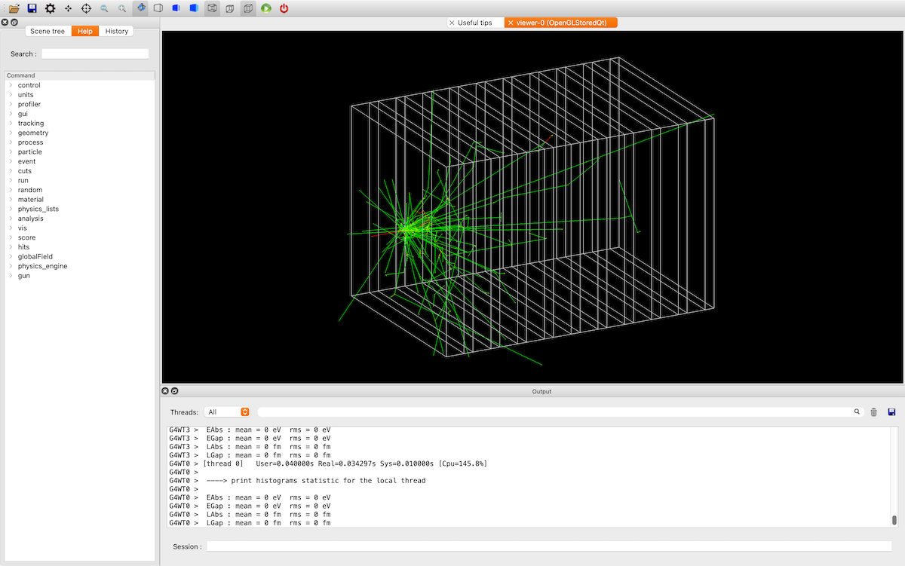

# B4したい（`examples/basic/B4`）



B4の題材は電磁カロリメータです。
液体アルゴンと鉛の層を重ねた、サンドイッチ構造になっています。
層の数は10、吸収板（鉛）は厚さ10 mm、ギャップ（液体アルゴン）は厚さ5 mm、正方形の断面は一辺10 cmです。

`examples/basic/B4/`の中には、`B4a`、`B4b`、`B4c`、`B4d`のディレクトリがあります。
同じ装置をシミュレーションしますが、測定したデータの集計方法が違います（後の「4つのバリアントの違い」を参照）。

`B4a`から`B4d`は、それぞれ独立したプロジェクトです。
使いたいものだけをコピーして、ビルドします。

## ビルドしたい（`B4a`）

```console
// サンプルと作業ディレクトリを設定する（パスは自分の環境に合わせる）
$ export G4EXAMPLE=~/geant4/v11.X.Y/install/share/Geant4/examples/basic/B4/B4a
$ export G4WORK=~/repos/sandbox/g4work

// 作業ディレクトリにコピーして移動する
$ mkdir -p $G4WORK
$ cp -R $G4EXAMPLE $G4WORK/
$ cd $G4WORK/B4a

// ビルドする
$ cmake -S . -B build
$ cmake --build build --parallel

// 実行する
$ cd build
$ ./exampleB4a -m run1.mac    # バッチモード
$ ./exampleB4a                # 対話モード

// クリーンする
$ cd $G4WORK/B4a
$ cmake --build build --target clean    # ビルドした実行ファイルなどを削除する
$ rm -r build                           # ビルド用ディレクトリごと削除する
```

`cmake`でビルドし、`exampleB4a`という実行ファイルを作成します。
手順の詳しい説明は、[付属サンプルの遊び方](geant4-examples)を参照してください。

:::{note}

B4の実行ファイルは、マクロを位置引数ではなく、`-m`オプションで受け取ります。
`./exampleB4a run1.mac`のように書くと、使い方が表示されて終了します。

:::

## ビルドしたい（`B4b`）

```console
// サンプルと作業ディレクトリを設定する（パスは自分の環境に合わせる）
$ export G4EXAMPLE=~/geant4/v11.X.Y/install/share/Geant4/examples/basic/B4/B4b
$ export G4WORK=~/repos/sandbox/g4work

// 作業ディレクトリにコピーして移動する
$ mkdir -p $G4WORK
$ cp -R $G4EXAMPLE $G4WORK/
$ cd $G4WORK/B4b

// ビルドする
$ cmake -S . -B build
$ cmake --build build --parallel

// 実行する
$ cd build
$ ./exampleB4b -m run1.mac    # バッチモード
$ ./exampleB4b                # 対話モード

// クリーンする
$ cd $G4WORK/B4b
$ cmake --build build --target clean    # ビルドした実行ファイルなどを削除する
$ rm -r build                           # ビルド用ディレクトリごと削除する
```

実行ファイルは`exampleB4b`です。
手順は`B4a`と同じです。

## ビルドしたい（`B4c`）

```console
// サンプルと作業ディレクトリを設定する（パスは自分の環境に合わせる）
$ export G4EXAMPLE=~/geant4/v11.X.Y/install/share/Geant4/examples/basic/B4/B4c
$ export G4WORK=~/repos/sandbox/g4work

// 作業ディレクトリにコピーして移動する
$ mkdir -p $G4WORK
$ cp -R $G4EXAMPLE $G4WORK/
$ cd $G4WORK/B4c

// ビルドする
$ cmake -S . -B build
$ cmake --build build --parallel

// 実行する
$ cd build
$ ./exampleB4c -m run1.mac    # バッチモード
$ ./exampleB4c                # 対話モード

// クリーンする
$ cd $G4WORK/B4c
$ cmake --build build --target clean    # ビルドした実行ファイルなどを削除する
$ rm -r build                           # ビルド用ディレクトリごと削除する
```

実行ファイルは`exampleB4c`です。
手順は`B4a`と同じです。

## ビルドしたい（`B4d`）

```console
// サンプルと作業ディレクトリを設定する（パスは自分の環境に合わせる）
$ export G4EXAMPLE=~/geant4/v11.X.Y/install/share/Geant4/examples/basic/B4/B4d
$ export G4WORK=~/repos/sandbox/g4work

// 作業ディレクトリにコピーして移動する
$ mkdir -p $G4WORK
$ cp -R $G4EXAMPLE $G4WORK/
$ cd $G4WORK/B4d

// ビルドする
$ cmake -S . -B build
$ cmake --build build --parallel

// 実行する
$ cd build
$ ./exampleB4d -m run1.mac    # バッチモード
$ ./exampleB4d                # 対話モード

// クリーンする
$ cd $G4WORK/B4d
$ cmake --build build --target clean    # ビルドした実行ファイルなどを削除する
$ rm -r build                           # ビルド用ディレクトリごと削除する
```

実行ファイルは`exampleB4d`です。
手順は`B4a`と同じです。
`B4d`の出力ファイル（ROOT形式など）と、そのプロットの方法は、後の「スコアリングしたい（`B4d`）」を参照してください。

## 4つのバリアントの違い

4つのバリアントは、同じ装置で、データの集計方法だけが違います。

| バリアント | 集計の方法 | 特徴 |
| --- | --- | --- |
| `B4a` | ユーザーアクション（`EventAction`、`SteppingAction`） | もっとも単純で、集計の流れが追いやすい |
| `B4b` | 独自のデータクラス（`RunData`、`G4Run`を継承） | ユーザーアクションどうしの依存を減らせる |
| `B4c` | ヒットとSensitive Detector（`CalorimeterSD`、`CalorHit`） | 層ごとの値も記録できる |
| `B4d` | スコアラー（`G4MultiFunctionalDetector`と`G4PS...`） | 独自のクラスを書かず、ntupleとして出力できる |

`B4a`で手で集計していた処理を、`B4c`ではヒットに、`B4d`ではスコアラーに任せています。
同じ結果を、どの段階で集計するかの違いとして比べると理解しやすくなります。

## 実行時の引数

B4の実行ファイルは、次のオプションを受け取ります。

| オプション | 意味 |
| --- | --- |
| `-m マクロ`（例：`-m run1.mac`） | マクロを実行する（バッチモード） |
| `-u セッション`（例：`-u Qt`） | 対話モードで使うUIセッションを指定する |
| `-t スレッド数`（例：`-t 4`） | マルチスレッドのスレッド数を指定する |

引数を付けずに実行すると、対話モードになります。

## 形状を作りたい（`DetectorConstruction`）

層は、吸収板とギャップを1組にした箱（`layer`）で、それを10枚並べています。
`B4d`では、`G4PVReplica`で層を繰り返し配置しています。

```cpp
// B4d::DetectorConstruction::Construct()（一部）
G4int nofLayers = 10;
G4double absoThickness = 10. * mm;
G4double gapThickness = 5. * mm;
G4double calorSizeXY = 10. * cm;

auto layerThickness = absoThickness + gapThickness;

auto layerS = new G4Box("Layer",  // its name
                        calorSizeXY / 2, calorSizeXY / 2, layerThickness / 2);  // its size
auto layerLV = new G4LogicalVolume(layerS,  // its solid
                                   defaultMaterial,  // its material
                                   "Layer");  // its name

new G4PVReplica("Layer",  // its name
                layerLV,  // its logical volume
                calorLV,  // its mother
                kZAxis,  // axis of replication
                nofLayers,  // number of replica
                layerThickness);  // witdth of replica
```

層の中に、吸収板（`Absorber`、鉛）とギャップ（`Gap`、液体アルゴン）を配置しています。

## 材質を作りたい（`G4Material`）

B4では、3つの材質を使っています。

- `G4_Pb`（鉛）：`FindOrBuildMaterial`で、データベースから取得します。
- `liquidArgon`（液体アルゴン）：元素（Z = 18、A = 39.95 g/mol）から、密度を指定して作ります。
- `Galactic`（真空に近い空間）：ワールドと層（吸収板とギャップを囲む空間）の材質です。

```cpp
// liquidArgon：単一の元素から作る
new G4Material("liquidArgon", z = 18., a = 39.95 * g / mole, density = 1.390 * g / cm3);
```

## 物理リストしたい（`FTFP_BERT`）

物理リストは、`FTFP_BERT`をそのまま使っています。
`main()`で`new FTFP_BERT`として登録しています。

## 一次粒子したい（`PrimaryGeneratorAction`）

一次粒子は1個で、カロリメータの入射面に垂直に入射します。
粒子の種類とエネルギーは、マクロ（`/gun/particle`、`/gun/energy`）で変更できます。

## `run1.mac`と`run2.mac`で流れを確認したい

`run1.mac`は、ミューオン（`mu+`）を300 MeVで入射し、条件を少しずつ変えていきます。

```cfg
/run/initialize
/gun/particle mu+
/gun/energy 300 MeV
/run/beamOn 1
/run/printProgress 5
/run/beamOn 10
/process/inactivate msc      # 多重散乱をオフにする
/run/beamOn 10
/globalField/setValue 2 0 0 tesla    # 磁場を加える
/run/beamOn 10
/process/activate msc        # 多重散乱をオンに戻す
/run/beamOn 10
/tracking/verbose 2
/run/beamOn 1
```

`run2.mac`は、既定の粒子を10000イベント入射します。

```cfg
/run/initialize
/run/printProgress 1000
/run/beamOn 10000
```

## スコアリングしたい（`B4d`）

`B4d`では、吸収板とギャップに、`G4MultiFunctionalDetector`を登録しています。
吸収板には、エネルギー付与（`G4PSEnergyDeposit`）と飛跡長（`G4PSTrackLength`）を登録しています。
飛跡長は、荷電粒子だけを数えるように、フィルター（`G4SDChargedFilter`）を付けています。

```cpp
// B4d::DetectorConstruction::ConstructSDandField()（一部）
auto absDetector = new G4MultiFunctionalDetector("Absorber");
G4SDManager::GetSDMpointer()->AddNewDetector(absDetector);

G4VPrimitiveScorer* primitive;
primitive = new G4PSEnergyDeposit("Edep");
absDetector->RegisterPrimitive(primitive);

primitive = new G4PSTrackLength("TrackLength");
auto charged = new G4SDChargedFilter("chargedFilter");
primitive->SetFilter(charged);
absDetector->RegisterPrimitive(primitive);

SetSensitiveDetector("AbsoLV", absDetector);
```

`main()`では、`G4TScoreNtupleWriter`を作成しています。
これで、スコアラーの結果がntupleとして出力されます。
既定の出力形式はROOTです。ROOTのファイルは、付属の`plotNtuple.C`などで図にできます。

```cpp
// B4d::main()（一部）
G4TScoreNtupleWriter<G4AnalysisManager> scoreNtupleWriter;
scoreNtupleWriter.SetVerboseLevel(1);
scoreNtupleWriter.SetNtupleMerging(true);
```

:::{note}

`B4d`は、ユーザーが独自のヒットクラスやSensitive Detectorクラスを書かなくても、スコアを記録できる例です。
`B2`の`TrackerSD`や、`B4c`の`CalorimeterSD`と比べると、その違いが分かります。

:::

## リファレンス

- [Example B4](https://geant4-userdoc.web.cern.ch/Doxygen/examples_doc/html/ExampleB4.html)
