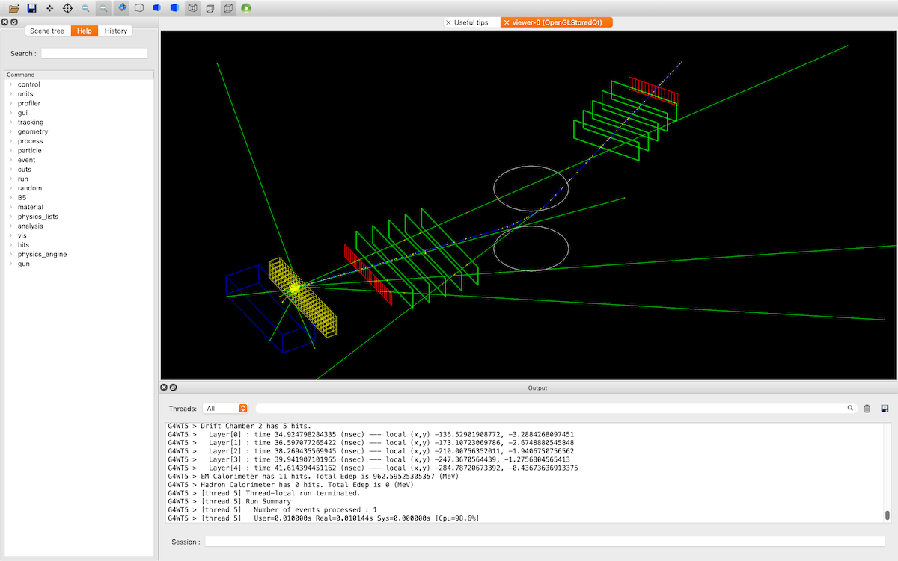

# B5したい（`examples/basic/B5`）



B5の題材は、複合的なビームテストです。
2つの検出器のアーム（腕）があり、磁場で曲げた粒子の運動量を測ります。
ビーム軸には、電磁カロリメーター（黄）、ハドロンカロリメーター（青）、ホドスコープ（赤）、トラッカー（緑）が設置されています。

## ビルドしたい

```console
// サンプルと作業ディレクトリを設定する（パスは自分の環境に合わせる）
$ export G4EXAMPLE=~/geant4/v11.X.Y/install/share/Geant4/examples/basic/B5
$ export G4WORK=~/repos/sandbox/g4work

// 作業ディレクトリ（B5/app）にコピーして移動する
$ mkdir -p $G4WORK/B5
$ cp -R $G4EXAMPLE $G4WORK/B5/app
$ cd $G4WORK/B5

// ビルドする（ソースは app/、ビルド用ディレクトリは build/）
$ cmake -S app -B build
$ cmake --build build --parallel

// 実行する
$ cd build
$ ./exampleB5 run1.mac    # バッチモード
$ ./exampleB5             # 対話モード

// クリーンする
$ cd $G4WORK/B5
$ cmake --build build --target clean    # ビルドした実行ファイルなどを削除する
$ rm -r build                           # ビルド用ディレクトリごと削除する
```

`cmake`でビルドし、`exampleB5`という実行ファイルを作成します。
ソースは`B5/app`に、ビルド用ディレクトリは`B5/build`に分けます（out-of-sourceビルド）。
手順の詳しい説明は、[付属サンプルの遊び方](geant4-examples)を参照してください。

## 検出器の構成を確認したい

検出器は、2つのアームと、その間にある磁場の領域で構成されています。

- **第1のアーム**：ホドスコープ（縦方向の細い帯状のシンチレータ15本）と、ドリフトチェンバー（水平な5層のアルゴンガス）
- **第2のアーム**：ホドスコープ（25本）、ドリフトチェンバー、電磁カロリメーター（CsIの結晶）、ハドロンカロリメーター（鉛の中に、シンチレータを挟んだセル）
- **磁場の領域**：空気で満たされた円柱。スペクトロメーターの中心（ピボット）に置かれ、粒子を曲げます

第1のアームは、入射粒子の位置と時間を測ります。
第2のアームは、磁場で曲げられた粒子の位置、時間、エネルギーを測ります。

## アームの角度を変えたい（`/B5/detector/armAngle`）

第2のアームの回転角は、コマンドで変えられます。
`G4GenericMessenger`で、コマンドを簡単に定義できます。

```cpp
// B5::DetectorConstruction::DefineCommands()（一部）
fMessenger = new G4GenericMessenger(this, "/B5/detector/", "Detector control");

auto& armAngleCmd = fMessenger->DeclareMethodWithUnit(
  "armAngle", "deg", &DetectorConstruction::SetArmAngle, "Set rotation angle of the second arm.");
armAngleCmd.SetParameterName("angle", true);
armAngleCmd.SetRange("angle>=0. && angle<180.");
armAngleCmd.SetDefaultValue("30.");
```

- `DeclareMethodWithUnit`：メソッドに対応するコマンドを作ります。単位（`deg`）も指定できます。
- `SetRange`：入力できる範囲を制限します。
- `SetDefaultValue`：省略したときの値を指定します。

## 磁場の強さを変えたい（`/B5/field/value`）

磁場は、`G4MagneticField`を継承した`MagneticField`クラスで定義しています。
磁場の強さも、`G4GenericMessenger`のコマンドで変えられます。

```cpp
// B5::MagneticField::DefineCommands()（一部）
fMessenger = new G4GenericMessenger(this, "/B5/field/", "Field control");

auto& valueCmd = fMessenger->DeclareMethodWithUnit("value", "tesla", &MagneticField::SetField,
                                                   "Set field strength.");
valueCmd.SetParameterName("field", true);
valueCmd.SetDefaultValue("1.");
```

## 磁場を定義したい（`G4MagneticField`）

磁場は、`G4MagneticField`を継承して、位置ごとの磁場の値を返すクラスとして作ります。
`B5`の磁場は、y方向の一様な磁場です。

```cpp
// B5::MagneticField（一部）
class MagneticField : public G4MagneticField
{
  public:
    void GetFieldValue(const G4double point[4], double* bField) const override;

  private:
    G4double fBy = 1.0 * CLHEP::tesla;
};

// B5::MagneticField::GetFieldValue()
void MagneticField::GetFieldValue(const G4double[4], double* bField) const
{
  bField[0] = 0.;    // Bx
  bField[1] = fBy;   // By
  bField[2] = 0.;    // Bz
}
```

`GetFieldValue()`は、引数の`point`（位置と時刻）を受け取り、`bField`に磁場の成分（x、y、z）を入れます。
位置によって値を変えれば、一様ではない磁場も作れます。

## 入射粒子したい（`/B5/generator/`）

入射粒子の運動量や角度の広がりは、`PrimaryGeneratorAction`の`G4GenericMessenger`で変えられます。

| コマンド | 役割 |
| --- | --- |
| `/B5/generator/momentum`（単位：GeV） | 運動量 |
| `/B5/generator/sigmaMomentum`（単位：MeV） | 運動量の広がり |
| `/B5/generator/sigmaAngle`（単位：deg） | 角度の広がり |
| `/B5/generator/randomizePrimary`（`true`/`false`） | 入射位置をランダムにするかどうか |

粒子の種類は、Geant4の標準コマンドである`/gun/particle`で変えます。

## 乱数で入射粒子したい（`PrimaryGeneratorAction`）

`randomizePrimary`が`true`のとき（既定値）、入射粒子を乱数で5種類から選びます。

```cpp
// B5::PrimaryGeneratorAction::GeneratePrimaries()（一部）
G4ParticleDefinition* particle;
if (fRandomizePrimary) {
  auto i = (int)(5. * G4UniformRand());
  switch (i) {
    case 0:
      particle = fPositron;
      break;
    case 1:
      particle = fMuon;
      break;
    case 2:
      particle = fPion;
      break;
    case 3:
      particle = fKaon;
      break;
    default:
      particle = fProton;
      break;
  }
  fParticleGun->SetParticleDefinition(particle);
}
else {
  particle = fParticleGun->GetParticleDefinition();
}
```

`G4UniformRand()`は0以上1未満の一様乱数です。
`5. * G4UniformRand()`を整数にすると、0から4までの番号が等しい確率で得られます。

## 運動量のばらつきを入れたい（運動エネルギーの計算）

運動量と角度に、乱数でばらつきを加えます。
`G4ParticleGun`は運動エネルギーで粒子を指定するので、運動量から運動エネルギーを求めてから設定しています。

```cpp
// B5::PrimaryGeneratorAction::GeneratePrimaries()（一部）
auto pp = fMomentum + (G4UniformRand() - 0.5) * fSigmaMomentum;
auto mass = particle->GetPDGMass();
auto ekin = std::sqrt(pp * pp + mass * mass) - mass;
fParticleGun->SetParticleEnergy(ekin);

auto angle = (G4UniformRand() - 0.5) * fSigmaAngle;
fParticleGun->SetParticleMomentumDirection(G4ThreeVector(std::sin(angle), 0., std::cos(angle)));
```

- `(G4UniformRand() - 0.5) * fSigmaMomentum`で、運動量を中心の値の前後にばらつかせます。
- 運動エネルギーは、相対論の関係式`E = sqrt(p² + m²) - m`で求めます。ここで`m`は粒子の質量です。
- 角度も同じ考え方で、ビームの向きをばらつかせています。

## 検出器の種類ごとにSensitive Detectorを割り当てたい

各検出器には、用途に合わせたSensitive Detectorを割り当てています。

```cpp
// B5::DetectorConstruction::ConstructSDandField()（一部）
auto hodoscope1 = new HodoscopeSD(SDname = "/hodoscope1");
fHodoscope1Logical->SetSensitiveDetector(hodoscope1);

auto chamber1 = new DriftChamberSD(SDname = "/chamber1");
fWirePlane1Logical->SetSensitiveDetector(chamber1);

auto emCalorimeter = new EmCalorimeterSD(SDname = "/EMcalorimeter");
fCellLogical->SetSensitiveDetector(emCalorimeter);

auto hadCalorimeter = new HadCalorimeterSD(SDname = "/HadCalorimeter");
fHadCalScintiLogical->SetSensitiveDetector(hadCalorimeter);
```

ホドスコープ、ドリフトチェンバー、2つのカロリメーターで、それぞれ別のクラスを使っています。
ヒットのクラス（`HodoscopeHit`、`DriftChamberHit`など）も、検出器ごとに作っています。

## 同じ板への複数のヒットをまとめたい（`HodoscopeSD`）

ホドスコープは、同じ板に粒子が何回入っても、ヒットを1つにまとめます。
板の番号（コピー番号）で既存のヒットを探し、あれば時刻の早いほうを残します。
エネルギーは、この処理では加算しません。

```cpp
// B5::HodoscopeSD::ProcessHits()（一部）
auto edep = step->GetTotalEnergyDeposit();
if (edep == 0.) return true;

auto preStepPoint = step->GetPreStepPoint();
auto copyNo = preStepPoint->GetTouchable()->GetVolume()->GetCopyNo();
auto hitTime = preStepPoint->GetGlobalTime();

// この板にすでにヒットがあるか探す
auto ix = -1;
for (std::size_t i = 0; i < fHitsCollection->entries(); ++i) {
  if ((*fHitsCollection)[i]->GetID() == copyNo) {
    ix = i;
    break;
  }
}

if (ix >= 0) {
  // あれば、時刻の早いほうを残す
  if ((*fHitsCollection)[ix]->GetTime() > hitTime) {
    (*fHitsCollection)[ix]->SetTime(hitTime);
  }
}
else {
  // なければ、新しいヒットを作る
  // （位置、回転、論理ボリュームなどを設定して、fHitsCollection->insert(hit)）
}
```

## ヒットの位置をローカル座標に変換したい（`DriftChamberSD`）

ドリフトチェンバーのヒットは、ワールド座標とローカル座標の両方で位置を記録します。
ローカル座標は、そのボリュームの中での位置です。

```cpp
// B5::DriftChamberSD::ProcessHits()（一部）
auto preStepPoint = step->GetPreStepPoint();

auto touchable = preStepPoint->GetTouchable();
auto motherPhysical = touchable->GetVolume(1);  // 母ボリューム
auto copyNo = motherPhysical->GetCopyNo();

auto worldPos = preStepPoint->GetPosition();
auto localPos = touchable->GetHistory()->GetTopTransform().TransformPoint(worldPos);

auto hit = new DriftChamberHit(copyNo);
hit->SetWorldPos(worldPos);
hit->SetLocalPos(localPos);
hit->SetTime(preStepPoint->GetGlobalTime());
fHitsCollection->insert(hit);
```

- `GetTopTransform()`は、そのボリュームの座標変換を返します。
- `TransformPoint(worldPos)`で、ワールド座標の位置をローカル座標に変換しています。
- `GetVolume(1)`は、1つ上の階層（母ボリューム）を指します。このコードでは、その母ボリュームのコピー番号を、ヒットに記録しています。

## 電磁カロリメーターのセルを配置したい（`G4PVParameterised`）

電磁カロリメーターのセル（CsI）は、`CellParameterisation`クラスで位置を決めて、`G4PVParameterised`で配置しています。

```cpp
// B5::DetectorConstruction（一部）
G4VPVParameterisation* cellParam = new CellParameterisation();
new G4PVParameterised("cellPhysical", fCellLogical, emCalorimeterLogical, kXAxis, kNofEmCells,
                      cellParam);
```

セルを1つずつ配置する`G4PVPlacement`と違い、同じ形のものを規則的に並べられます。

## 物理リストしたい（`FTFP_BERT`と`G4StepLimiterPhysics`）

物理リストは、`FTFP_BERT`に`G4StepLimiterPhysics`を追加しています。
磁場の中で飛跡を正しく計算するために、ステップ長の上限を設定するためです。

## ヒストグラムとntupleに出力したい

`RunAction`では、ドリフトチェンバーのヒット数を、1次元のヒストグラムと2次元のヒストグラムに出力しています。
ntupleには、ドリフトチェンバーのヒット数とカロリメーターのエネルギーを記録します。

```cpp
// B5::RunAction（一部）
analysisManager->CreateH1("Chamber1", "Drift Chamber 1 # Hits", 50, 0., 50);  // h1 Id = 0
analysisManager->CreateH1("Chamber2", "Drift Chamber 2 # Hits", 50, 0., 50);  // h1 Id = 1

analysisManager->CreateH2("Chamber1 XY", "Drift Chamber 1 X vs Y",  // h2 Id = 0
                          /* ... */);

analysisManager->CreateNtuple("B5", "Hits");
analysisManager->CreateNtupleIColumn("Dc1Hits");  // column Id = 0
analysisManager->CreateNtupleIColumn("Dc2Hits");  // column Id = 1
analysisManager->CreateNtupleDColumn("ECEnergy");  // column Id = 2
```

ヒストグラムとntupleの番号は、作成した順に対応しています。

## `run1.mac`と`run2.mac`で流れを確認したい

`run1.mac`は、アームの角度、磁場、運動量を変えながら、少ないイベント数で条件を比べます。

```cfg
/run/initialize
/run/beamOn 3
/B5/detector/armAngle 0. deg
/B5/field/value 0. tesla
/run/beamOn 3
/B5/detector/armAngle 60. deg
/B5/field/value 2. tesla
/run/beamOn 3
```

`run2.mac`は、陽子、π+、e+を順に入射し、粒子ごとに別のファイルに結果を保存します。
`/analysis/setFileName`で、ヒストグラムのファイル名を、`/analysis/ntuple/setFileName`で、ntupleのファイル名を指定しています。

```cfg
/run/initialize
/B5/generator/randomizePrimary FALSE
/gun/particle proton
/B5/generator/momentum 100. GeV
/B5/field/value 100. tesla
/analysis/setFileName B5_proton
/analysis/ntuple/setFileName 0 B5ntuple_proton
/run/beamOn 30
```

## リファレンス

- [Example B5](https://geant4-userdoc.web.cern.ch/Doxygen/examples_doc/html/ExampleB5.html)
