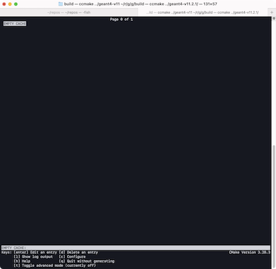
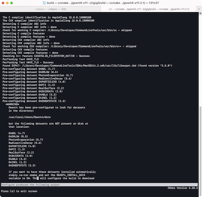

# ビルドを確認する（`ccmake`）

```console
// ステップ1：バージョンごとの作業ディレクトリに移動する
$ cd ~/geant4/v11.4.3/

// ステップ2：ソースとビルドのディレクトリを指定して起動する
$ ccmake -S source -B build
```

`ccmake`でビルドオプションをターミナル上で視覚的に変更できます。
インストール先となる`CMAKE_INSTALL_PREFIX`の設定が正しいことを確認します。
Qtを使う場合は、`CMAKE_PREFIX_PATH`にQtのインストール先が設定されていることを確認してください。

`GEANT4_USE`系の設定フラグは、この画面でトグルして変更できます。
変更を加えたら、次の順で実行します。

1. `[c] Configure`：キャッシュ（`CMakeCache.txt`）に変更を反映する
2. `[g] Generate`：ビルドシステムのファイルを生成する

:::{figure-md}


ビルドオプションの確認（ページ1）
:::

:::{figure-md}


ビルドオプションの確認（ページ2）
:::
